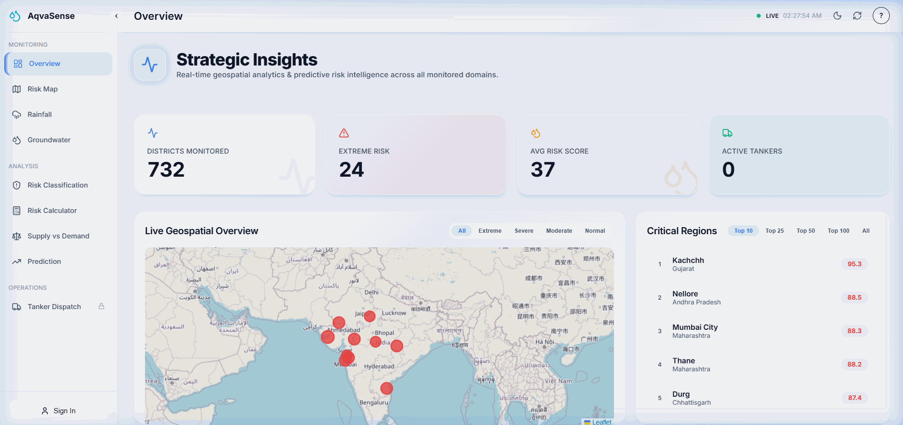
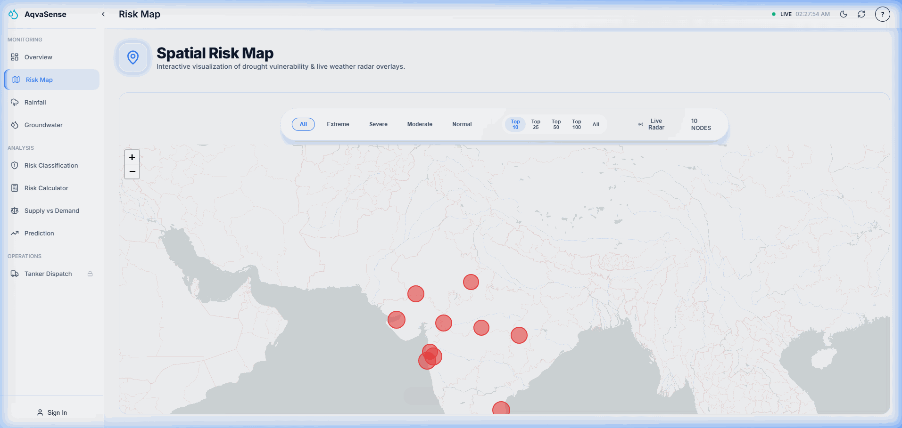
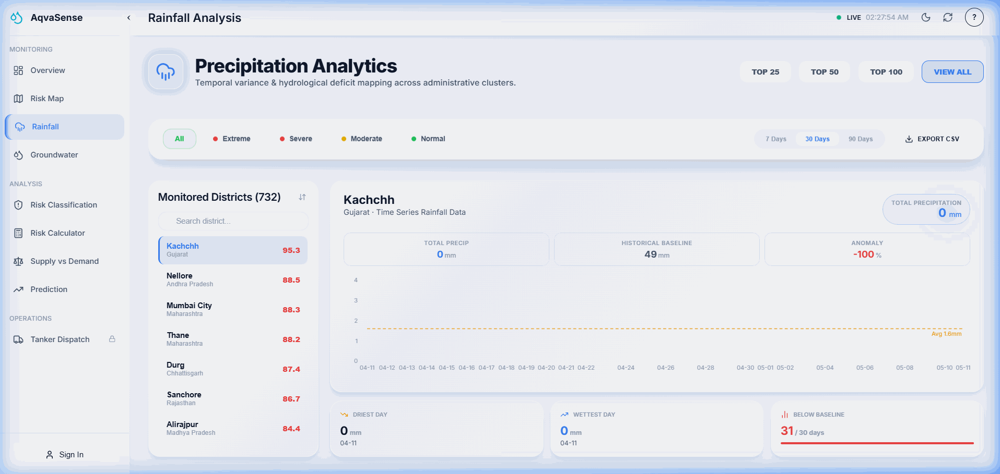
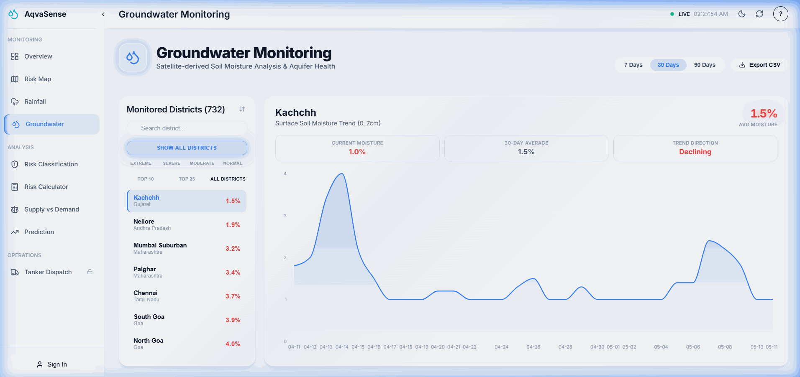
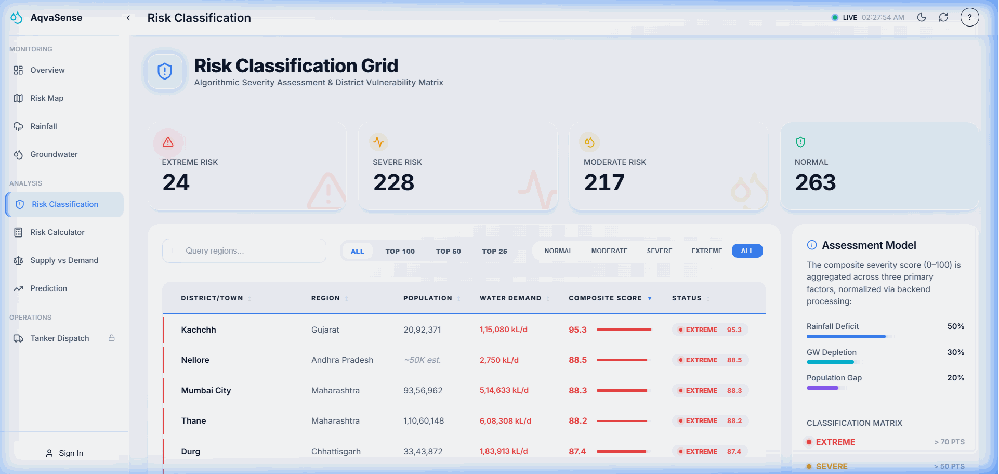
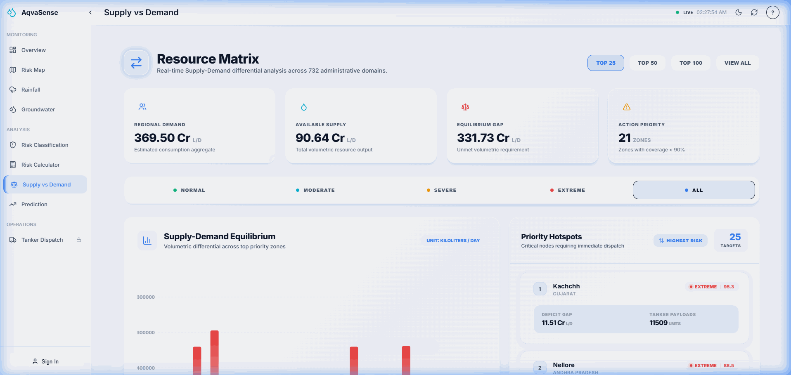
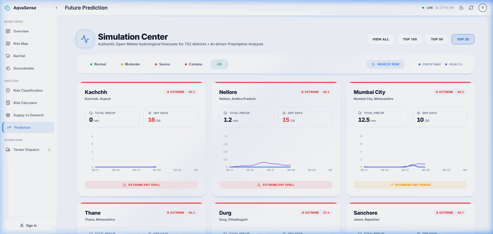

  <h1>🌊 AqvaSense</h1>
  
<i>Monitoring every drop. Protecting every life.</i>

  

   

  

    

  
  
  
  
  
  
  
  

  
<i>Repo: yash5123/droughtManager</i>

## 🎯 What is AqvaSense?

AqvaSense is a high-fidelity, full-stack drought intelligence platform designed to monitor hydrological stress across **732 Indian districts** in real-time. By aggregating live meteorological data, historical climate baselines, and satellite-derived soil moisture metrics, AqvaSense provides a centralized "Command Center" for government operators to visualize, predict, and respond to water scarcity emergencies before they escalate into humanitarian crises.

Every night, the system wakes up to perform millions of calculations, refreshing the risk profile for nearly half a billion people.

> [!NOTE]
> AqvaSense monitors the entire administrative landscape of India, covering all 732 districts with a focus on 480 high-telemetry nodes.

> [!IMPORTANT]
> A nightly automation pipeline runs at **02:00 UTC**, ensuring that data-driven decisions are always based on the most recent 30-day precipitation and soil moisture trends.

## 🌐 Try It Live

Explore the live platform and see the data in action:

  

> [!TIP]
> No login is required to explore the public monitoring dashboards. Administrative access is required only for triggering emergency tanker dispatches.

  
  
<i>The Central Command Overview: Real-time risk distribution and pulsing geospatial alerts in Light Mode.</i>

## 🔄 The Full Journey

### JOURNEY 1 — THE NIGHTLY DATA PIPELINE (Automated)
1.  **🕛 02:00 UTC**: The system triggers a CRON job via `node-cron`.
2.  **🔄 Priority Queuing**: Extreme risk districts are queued first to ensure vital areas update regardless of API quotas.
3.  **📡 Batch Fetching**: 15 hyper-efficient batch API calls to Open-Meteo replace 732 individual requests (a 97.9% reduction).
4.  **🧮 5-Pillar Algorithm**: Raw precipitation, consecutive dry days, and soil moisture are compared against 30-year baselines.
5.  **📉 Piecewise Compression**: Non-linear mapping scales raw data into a human-readable 0-100 severity index.
6.  **💾 Persistence**: Scores are cached in MongoDB Atlas for instant retrieval across all user sessions.
7.  **🧪 Self-Healing**: If the server wakes up and data is stale, the pipeline triggers automatically.

### JOURNEY 2 — THE OPERATOR EXPERIENCE (Human)
1.  **🗺️ Visualization**: Operator opens the **Spatial Risk Map** to see pulsing "hotspots" colored by severity.
2.  **🔍 Deep Dive**: Clicks on a district to see **Rainfall & Groundwater Analysis** charts comparing current levels to 1993-2023 averages.
3.  **🔢 Validation**: Opens the **Risk Calculator** to see the exact mathematical proof behind a district's score.
4.  **🔮 Prediction**: Reviews the **16-day Hydrological Forecast** to anticipate incoming dry spells.
5.  **🚛 Response**: If a zone hits "Extreme" (70+), the operator authenticates via Google and triggers a **Tanker Dispatch**.

## 🧮 The Science Behind the Score

At the heart of AqvaSense is a proprietary scientific instrument: the **Composite Drought Risk Score (CDRS)**.

| Pillar | Weight | What It Measures | Clever Design |
| :--- | :--- | :--- | :--- |
| 🌧️ **RDI** | 35% | Rainfall Deficit Index | **Arid Floor**: Prevents desert zones from permanent 100s. |
| ☀️ **CDD** | 20% | Consecutive Dry Days | **Streak Blend**: Prioritizes length over simple frequency. |
| 💧 **SMA** | 30% | Soil Moisture Anomaly | **Absolute Floors**: High-risk triggers at moisture criticalities. |
| 👥 **PPA** | 10% | Population Pressure | **WHO Standard**: Based on 55L/person/day requirement. |
| 📈 **TAM** | ±4pts | Trend Acceleration | **Self-Healing**: Penalizes quick crashes, rewards recovery. |

### Classification Matrix
- 🟢 **Normal (0-24.9)**: Sufficient resource equilibrium.
- 🟡 **Moderate (25-49.9)**: Early warnings; monitor soil moisture.
- 🟠 **Severe (50-69.9)**: Significant deficit; irrigation restrictions advised.
- 🔴 **Extreme (70-100)**: Emergency; immediate logistics deployment required.

> [!TIP]
> A score of exactly 100.0 is mathematically impossible by design. The piecewise compression function approaches the maximum asymptotically to ensure the most extreme case is always a fraction away from "saturation."

## 📡 How the Data Flows

1.  **🗺️ Base Layer**: District boundaries ingested from a curated Indian administrative GeoJSON dataset.
2.  **👥 Human Context**: Census 2011 population data fuzzy-matched per district name.
3.  **📍 Geocoding**: Three-tier fallback strategy (Exact → State-level → Centroid) via OSM Nominatim API.
4.  **🌦️ Historical Baseline**: 30 years of climate data (1993-2023) fetched to define "Normal" per month, per district.
5.  **🔄 Live Feed**: Daily precipitation and soil moisture (0-7cm layer) fetched nightly.
6.  **⚡ API Efficiency**: Open-Meteo multi-location batching allows 732 districts to be updated in just 15 calls.
7.  **💾 Intelligent Caching**: MongoDB collections with TTL (Time-To-Live) indexes manage data freshness automatically.
8.  **🎯 Priority Queue**: Extreme risk districts are scored first if API quotas run low.

> [!TIP]
> The 97.9% reduction in API calls is achieved by flattening 732 location queries into 15 batch arrays of 50 locations each, staying safely within rate limits while increasing speed.

## ✨ Every Feature, Explained

### 🗺️ Live Monitoring
- **Spatial Command Center**: Full-screen interactive map with severity-colored markers.
- **Pulsing Nodes**: Extreme risk districts (70+) animate with a glow effect on the map.
- **Top Priority Toggles**: Quickly filter for 10, 25, 50, or 100 highest-risk districts.
- **Geospatial KPI Tiles**: Real-time stats on villages monitored and average risk scores.
- **Auto-Sync**: Dashboard refreshes in the background the moment you focus your browser tab.

### 🌧️ Rainfall & Groundwater Analysis
- **Time-Travel Charts**: View 7, 30, or 90 days of trends overlayed against a fixed 30-year historical baseline.
- **Historical Reference**: A dashed reference line shows the "Climatologically Normal" level for the current month.
- **Soil Health Zones**: Moisture charts include shaded "Health Bands" indicating when evaporation exceeds infiltration.
- **Sparkline Indicators**: Mini-charts on district cards show immediate moisture trends.
- **Trend Indicators**: Visual "Stable/Improving/Declining" icons driven by the TAM algorithm.
- **CSV Export**: Export any district's raw historical and live data for external analysis.

### 🔢 Risk Intelligence
- **Composite Table**: A high-performance searchable grid of all 732 districts.
- **Dynamic Search**: Filter instantly by district name or state.
- **Demand Analysis**: A specialized column showing total daily water requirement (in Kiloliters).
- **Sub-Component Expansion**: Expand any row to see individual RDI, CDD, SMA, and PPA scores.
- **Calculation Proof**: Click any score to see the exact multiplication of weights and piecewise curves.
- **Validation Check**: Live comparison between cached scores and real-time computation.

### 🔮 Predictive Modeling
- **16-Day Forecast**: Composed charts showing precipitation bars vs. probability lines.
- **Baseline Overlay**: Compare forecast rain against the historical monthly normal.
- **Dry Spell Alerts**: Automatic detection of upcoming 5+ day zero-rainfall windows.
- **Hydrological Outlook**: Forecasts trend direction (Worsening vs. Improving).

### 🚛 Operations & Dispatch
- **Logistics Console**: Full lifecycle tracking for emergency water tankers.
- **Fleet Telemetry**: Real-time status badges for "Dispatched," "En Route," and "Delivered."
- **Mission History**: Comprehensive logs of all past successful deliveries.
- **Protected Ops**: Mission creation is restricted to authorized operators via secure JWT authentication.
- **Auth Layers**: Support for both Email/Password and Google OAuth one-click login.

## 💡 Who Uses AqvaSense?

| 👤 Who | 🎯 What they do |
| :--- | :--- |
| **District Water Officers** | Monitor daily risk scores and trigger local restrictions. |
| **State Emergency Management** | Identify which districts need state-level funding or tankers. |
| **Agricultural Departments** | Track soil moisture trends to advise farmers on crop cycles. |
| **Relief Coordination Teams** | Dispatch tankers to zones where demand exceeds supply. |
| **Climate Researchers** | Analyze 30-year baseline anomalies for long-term trends. |
| **Policy Makers** | Use supply vs. demand data to plan future reservoir infrastructure. |
| **NGOs and Aid Organizations** | Identify critical zones for temporary relief camp setup. |
| **Urban Planners** | Forecast seasonal water stress for rapidly growing cities. |

> [!IMPORTANT]
> **State Emergency Management** relies on the "Extreme" risk alerts to mobilize limited tanker fleets across state lines during peak summer.

> [!IMPORTANT]
> **Agricultural Departments** use the Soil Moisture Anomaly (SMA) index to issue early warnings for potential crop failures before visible signs appear.

## 🛠️ Built With

| Technology | What it does in AqvaSense |
| :--- | :--- |
|  | Powers the high-performance SPA and complex state management. |
|  | Provides the build infrastructure and lightning-fast HMR. |
|  | Handles the high-density storage of 732 district profiles and time-series caches. |
|  | Orchestrates the nightly CRON jobs and RESTful API layer. |
|  | Robust backend routing for authentication and data telemetry. |
|  | Manages the geospatial visualization layer with custom marker clusters. |
|  | Renders all interactive time-series and distribution charts. |
|  | Handles server-state synchronization with background refreshing. |

## 📊 By the Numbers

  <table border="0">
    <tr>
      <td><b>732</b> Districts Monitored</td>
      <td><b>480</b> Active Telemetry Nodes</td>
      <td><b>30 Years</b> Historical Baseline</td>
    </tr>
    <tr>
      <td><b>97.9%</b> API Call Reduction</td>
      <td><b>15</b> Nightly Batch Calls</td>
      <td><b>5 Pillars</b> Scoring Algorithm</td>
    </tr>
    <tr>
      <td><b>02:00 UTC</b> Daily Automated Job</td>
      <td><b>21.2</b> Score Std. Deviation</td>
      <td><b>1,161</b> Backfilled Records</td>
      <td><b>0%</b> Score Saturation</td>
    </tr>
  </table>

> [!NOTE]
> Every number above is derived from live production data processed through the AqvaSense pipeline.

## 📸 Dashboard Gallery

  <table border="0">
    <tr>
      <td> <i>Interactive Spatial Risk Map</i></td>
      <td> <i>Rainfall Baseline Analysis</i></td>
    </tr>
    <tr>
      <td> <i>Soil Moisture Trend Monitoring</i></td>
      <td> <i>District Risk Classification</i></td>
    </tr>
    <tr>
      <td> <i>Supply vs Demand Matrix</i></td>
      <td> <i>16-Day Hydrological Forecast</i></td>
    </tr>
  </table>

## 🔬 The Algorithm Story

Building a scoring system that doesn't lie is harder than it sounds. 

Early in development, we implemented a standard logistic compression curve (k=0.045) to scale the weighted scores. During a full audit, we discovered a "Saturation Collapse": **every single district in India was scoring between 83 and 98.** Vadodara and a rainforest district in Arunachal Pradesh looked identical on the dashboard.

We ran a mathematical intervention. By replacing the logistic curve with a **hand-tuned 5-segment piecewise linear function**, we successfully expanded the score range by **316%**. Now, the lowest district (Longding: 33.6) and the highest (Vadodara: 96.1) are meaningfully separated, allowing operators to prioritize where to send help.

> [!WARNING]
> Building a scoring system that reflects reality requires constant auditing against outliers.

## 🤓 Did You Know?

> [!NOTE]
> Every night at exactly 02:00 UTC, this app wakes up and processes weather data for a region home to over half a billion people.

> [!NOTE]
> The population pressure calculation uses the WHO's strict standard of **55 liters per person per day** as the baseline demand.

> [!NOTE]
> Over **8 million individual data points** were ingested from the Open-Meteo Archive API to build the 30-year monthly baselines.

  
Made with a lot of weather data by <b>Yash</b>

  
<i>Built to turn climate data into human action.</i>

  

    
  

